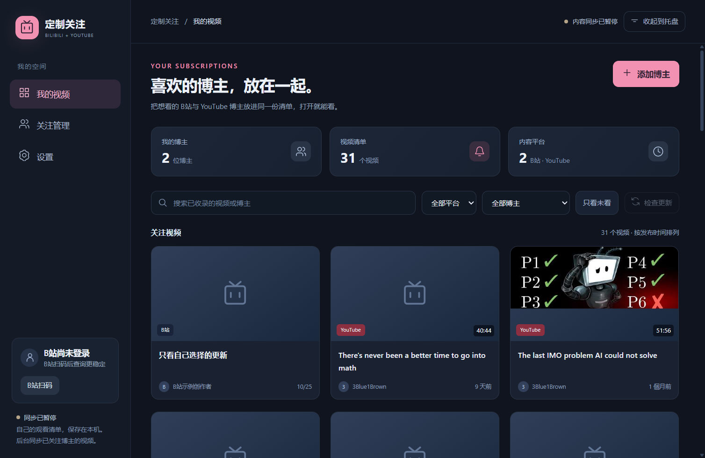
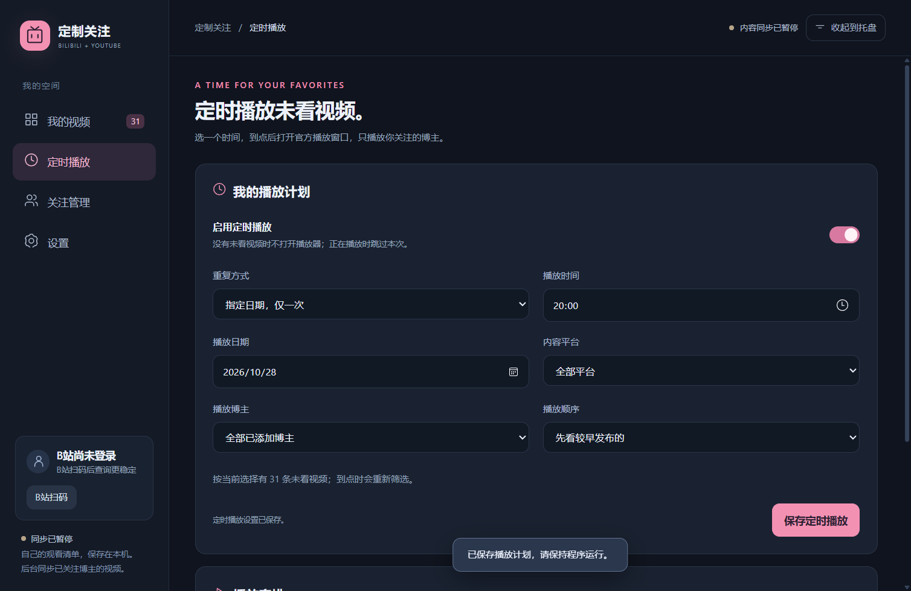

# 定制关注

一个自己的跨平台观看空间：把想看的 B站和 YouTube 博主放进同一份清单，在这里浏览和观看。

## 功能

- **双平台关注**：B站支持昵称、UID、空间主页链接；YouTube 支持频道主页、`@handle`、`UC…` 频道 ID。
- **可选通知**：托盘后台检查、桌面弹窗、声音开关、跨午夜免打扰、失败退避与重复提醒去重。
- **专注观看**：使用平台官方网页播放器，隐藏推荐栏、评论与页面信息流，保留画质、字幕和全屏选项。
- **我的关注连播**：在官方专注窗口中，播完后按当前清单顺序继续播放，只选择程序中已添加博主的作品，最后一条播完停止。支持 B站分 P、双平台切换和全屏继续观看。
- **定时播放未看视频**：每天固定时间或指定日期播放一次，可限定平台、某位博主和发布时间顺序。到点后从本地已收录的未看视频开始播放，已看视频和移除的博主会被跳过。
- **本地保存**：关注列表与设置保存在本机，B站扫码凭据由 Windows DPAPI 加密。公开的 YouTube 更新检查不需要 Google 登录。





上图为示例界面，示例频道不会自动加入你的关注列表。

## 运行

面向 Windows 10/11 x64，需要 Microsoft Edge WebView2 Runtime。

下载 Releases 中的 Windows 压缩包，完整解压后双击 `启动.cmd`。请保留 `CustomFollow` 文件夹整体。

1. 在“关注管理”选择 **B站** 或 **YouTube**。
2. 添加想看的创作者。B站查询遇到限制时，可在程序中扫码登录。
3. 首次添加只收录近期视频；之后发现新视频才弹窗提醒。
4. 点击视频进入官方网页专注播放；点击顶部“全屏”或按 **F11**，可隐藏标题栏、菜单、工具栏及任务栏。按 **Esc** 或再按 F11 退出，恢复之前的窗口状态。也可切换完整页面或嵌入备用模式。
5. 关闭主窗口会停止播放并收进托盘；在设置或托盘菜单选择“完全退出”可结束程序。托盘不可用时，关闭主窗口会直接退出。

1.3.0 加入侧栏“定时播放”：选择每天或单次、日期与时间、平台或博主，保存并启用即可。默认关闭；按电脑本地时间执行，只在所选分钟内启动，每次计划只执行一次并保存结果。程序需保持运行，可收起到托盘；完全退出、休眠或关机时不执行，错过时间不补播。已有播放时跳过本次，没有符合条件的视频时不打开窗口。播放使用当前已收录的视频，不会等待网络同步或转去推荐页；到点后会弹出官方播放窗口，并可能播放声音。

“未看”现在独立于更新通知的“已处理”状态。官方视频播到结尾后标记已看，B站多 P 以最后一 P 的结尾为准；提前关闭或播放失败不标记。卡片可手动标为已看或未看，嵌入备用模式与外部浏览器观看后请手动标记。记录不与平台观看历史同步；旧版本没有完成观看记录，因此迁移后的旧视频默认未看，原有通知处理记录保持不变。

“自动连播我的关注”默认开启；手动打开视频或定时计划启动后，播放页和独立窗口顶部均可开关。手动打开时使用打开视频时的筛选结果，定时播放则限定为未看清单，每次切换都重新跳过已看视频。不会转去站内推荐，也不会循环回开头。B站分 P 会先播完同一作品。返回列表、关闭播放窗口或收起主窗口会取消当前连播；已保存的后续定时计划继续有效。

自动连播用于默认的官方网页专注播放，嵌入备用模式保留手动操作。原有 YouTube 发布时间修正、真正全屏及关闭卡死修复继续保留。

检查依赖本机网络能够访问相应平台。程序不会改变代理、地区、登录或付费权限。

## YouTube 更新方式与边界

优先使用 YouTube 官方频道 Atom 更新源。若官方更新源不可用，读取**该频道的公开视频页**，最多保留近期 30 条，并用新视频编号及最新顺序识别更新。支持“10d ago”等新版时间缩写，并从对应视频的官方公开元数据逐步补充实际发布时间；已取得的准确时间保存在本地，后续不会被相对时间覆盖。

视频卡片显示发布年月日，悬停可看本地时区的具体时间。只取得相对时间时会标注“约”；官网仅给出发布日期时不虚构时分；未提供时间时显示未知，不用检查或收录时间代替。补正已有视频的时间不会重复发送更新通知。

网页备用方式暂不检查独立的 Shorts、直播分栏；首次导入和长时间离线也不会补齐全部历史视频。修改视频标题不会造成同一视频重复提醒。

YouTube 画质、字幕、广告、地区和账号权限由官方播放器决定。Google 可能限制嵌入式浏览器登录；如遇此情况，可用默认浏览器观看。此程序不会自动导入 Google 账号里的订阅列表。

## 从源码运行

安装 Python 3.12；Windows PowerShell 中运行：

```powershell
py -3.12 -m venv .venv
.\.venv\Scripts\python.exe -m pip install -r requirements.txt
.\.venv\Scripts\python.exe main.py
```

测试：

```powershell
.\.venv\Scripts\python.exe -m unittest discover -s tests -v
npm ci
npm test
```

构建 Windows 应用：

```powershell
powershell -NoProfile -ExecutionPolicy Bypass -File .\build.ps1
```

输出在 `CustomFollow`。重新构建不会删除已有 `data` 文件夹。

## 本机数据与升级

新安装默认保存在 `CustomFollow/data`。从早期 BiliFocus 版本升级时，如果旁边存在 `BiliFocus/data/state.json`，新版会继续使用原数据文件夹，保留登录与关注。请完全退出旧版再启动新版，避免两个实例同时运行。

`state.json` 包含个人关注与观看标记，`session.bin` 是当前 Windows 用户加密的登录凭据，`webview` 是平台浏览器数据。它们都不应上传到仓库或分享给他人；本仓库的 `.gitignore` 已排除这些目录。

项目只在本机运行，没有自己的业务服务器。平台请求直接发给 B站、YouTube 及其播放器所需服务。

## 资料

- [YouTube 官方更新通知说明](https://developers.google.com/youtube/v3/guides/push_notifications)
- [YouTube 频道网址与 Handle](https://support.google.com/youtube/answer/6180214)
- [B站官方外链播放器](https://player.bilibili.com/)

网站页面与接口会变化。若专注布局失效，可先切换完整官方页面，再反馈具体视频链接和错误；请勿附带 Cookie、登录二维码或整个 `data` 文件夹。
